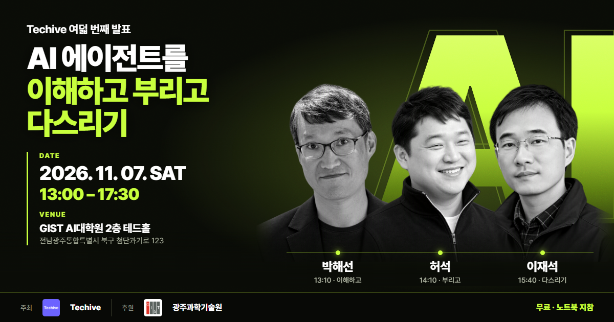
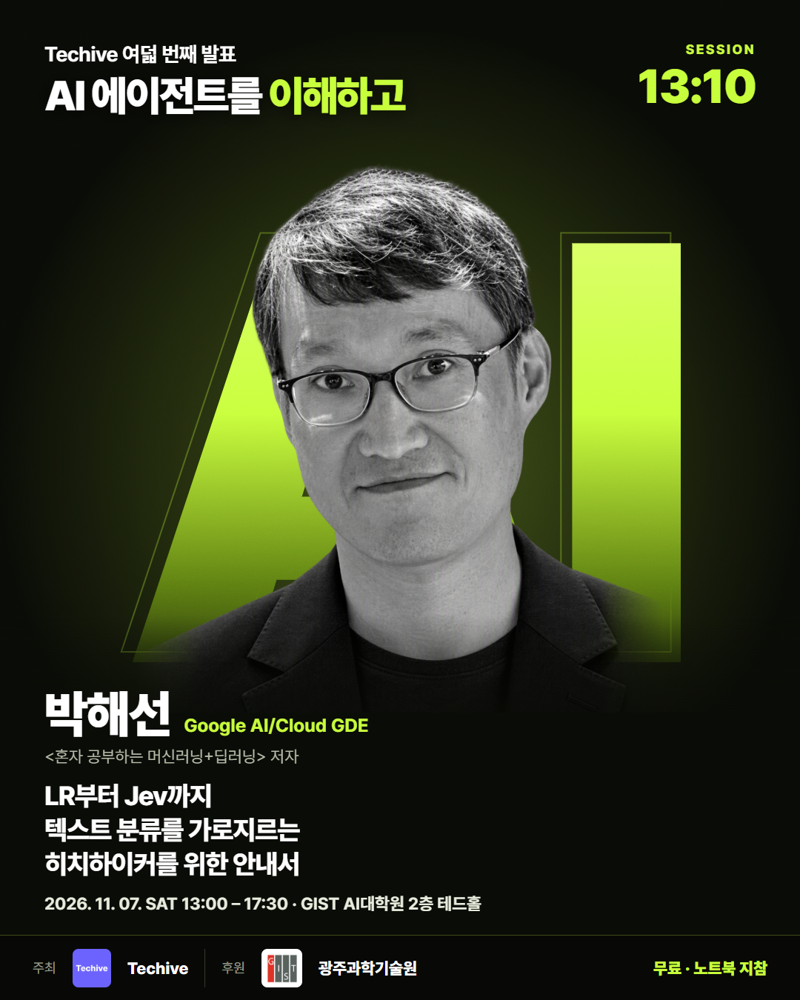
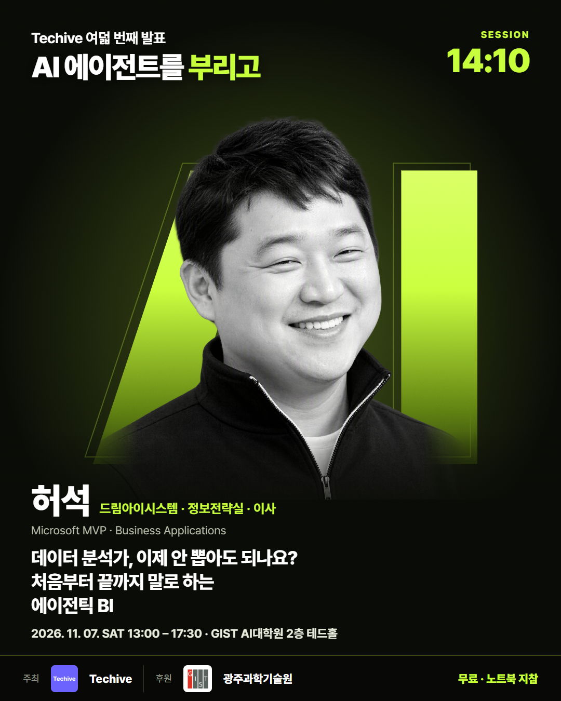
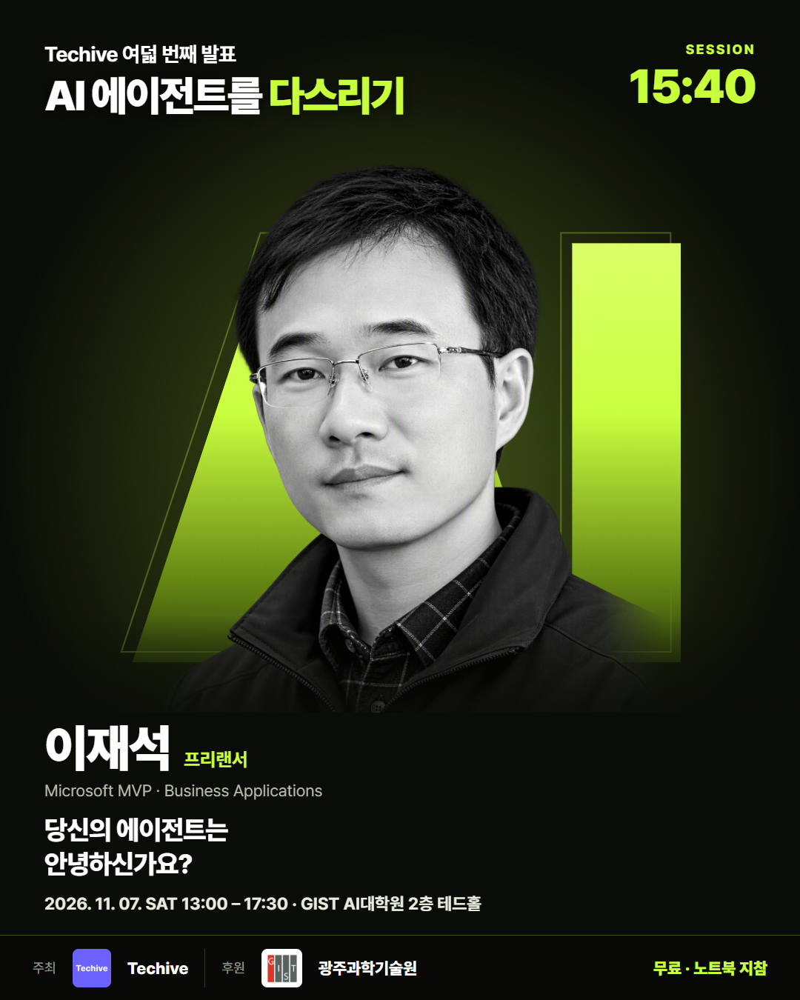
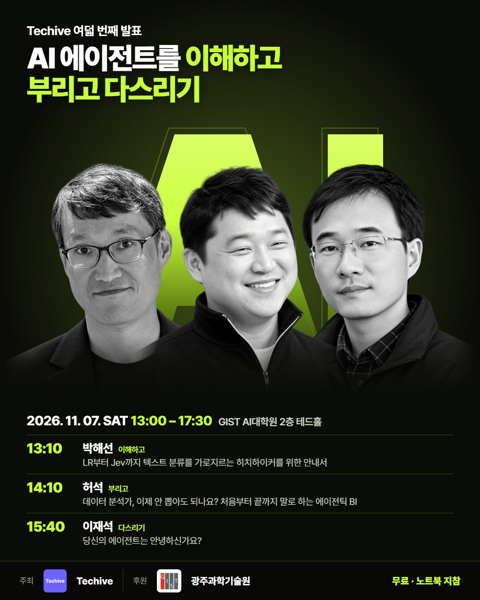
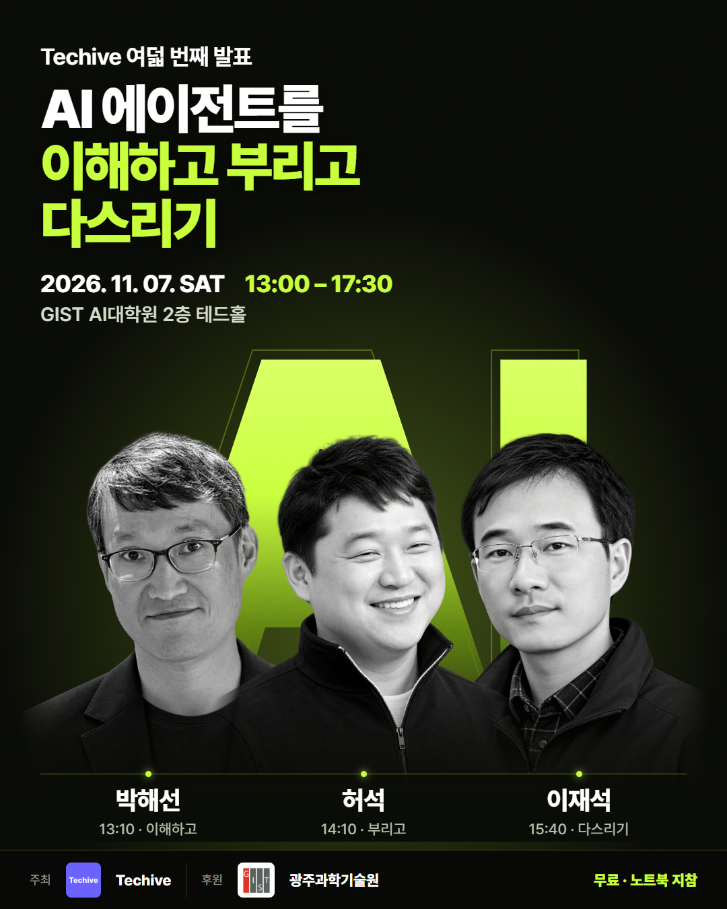
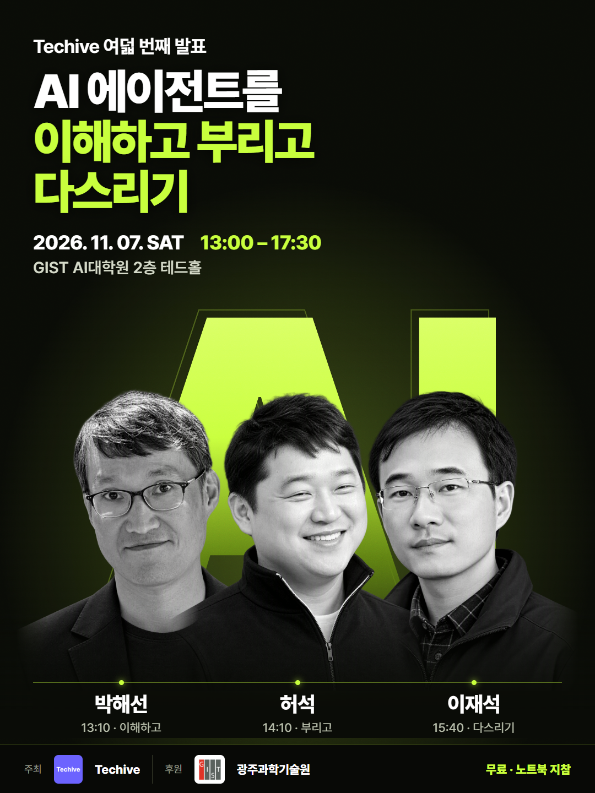

# Techive 여덟 번째 발표: AI 에이전트를 이해하고 부리고 다스리기

모델은 어떻게 진화했고, 분석은 어디까지 자동화되며, 늘어나는 에이전트는 어떻게 관리할까요? 3명의 AI 전문가가 한자리에서 알려드립니다.

- **안내 페이지**: https://power-platform-users-korea.github.io/techive-8th-ai-agent/
- **신청**: https://apply.event-us.kr/techive/event/137241/applicant?GroupId=Group0 (11월 6일(금) 23:30 마감, 무료)
- **일시**: 2026. 11. 07 (토) 13:00 ~ 17:30
- **장소**: 광주과학기술원(GIST) AI대학원 2층 테드홀 (전남광주통합특별시 북구 첨단과기로 123)
- **준비물**: 노트북 (핸즈온 세션 포함) · 간식, 음료, 김밥 제공
- **오거나이저**: 김현혜 · **스탭**: 김은송, 박진규 · **후원**: 광주과학기술원

## 폴더

| 폴더 | 내용 |
| --- | --- |
| [`guide/`](guide/) | 안내 페이지 |
| [`banners/`](banners/) | 행사 안내 포스터 4종: Facebook 1200×630, LinkedIn 1200×1200, Instagram 1080×1350, Threads 1080×1440 |
| [`posters/`](posters/) | 발표자별 포스터 3장과 발표자 단체 포스터, 1080×1350 |
| [`source/`](source/) | 포스터 생성 스크립트(`build.py`)와 인물 컷아웃·로고 원본 |

## 발표 일정

| 시간 | 내용 |
| --- | --- |
| 13:00 | 오프닝 |
| 13:10 | 박해선: LR부터 Jev까지 텍스트 분류를 가로지르는 히치하이커를 위한 안내서 |
| 14:10 | 허석: 데이터 분석가, 이제 안 뽑아도 되나요? 처음부터 끝까지 말로 하는 에이전틱 BI |
| 15:40 | 이재석: 당신의 에이전트는 안녕하신가요? |
| 17:00 | Q&A · 마무리 |

## 포스터

| | | |
| --- | --- | --- |
|  |  |  |
|  |  |  |

포스터 인물 이미지는 행사 페이지의 발표자 사진을 참조해 Azure AI Foundry 이미지 모델로 생성했습니다.
